# AKALABETH — World of Doom · Manual do jogador (MSX2, v0.4.0)

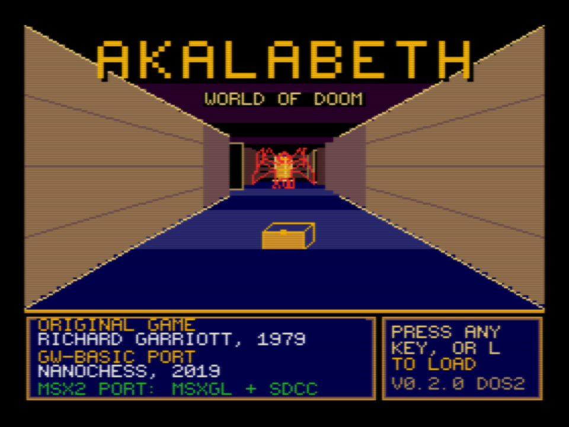

## 1. A história

Você é um camponês que quer virar cavaleiro. Lord British, senhor destas terras, só aceita quem
provar seu valor: vá às masmorras, mate os monstros que ele apontar, volte vivo e receba a próxima missão.
A última é o **Balrog**. Quem chegar lá e voltar vitorioso é sagrado **Lord**.

O jogo é o *Akalabeth* de Richard Garriott (1979), reescrito para o MSX2 a partir do porte para GW-BASIC de Nanochess.
As regras são as do original; a apresentação (cores, música, minimapa, salvar/carregar) é nova.

## 2. Como iniciar

- **Disco:** `akalabeth.dsk` (720 KB, MSX-DOS 2). Ligue o MSX2 com o disco no drive A: e o jogo inicia sozinho.
- **Só o programa:** copie `AKALABET.COM` (e, de preferência, `AKALABET.DAT`) para um disco com MSX-DOS e digite `AKALABET`. Sem o `.DAT` o jogo funciona, mas sem a abertura, a ajuda ilustrada, a tela de vitória e as músicas longas.
- **Emulador (openMSX):**
  ```
  openmsx -machine Philips_NMS_8250 -ext msxdos2 -diska akalabeth.dsk
  ```
- **Requisitos:** MSX2, 64 KB de VRAM, drive de disco. **Salvar/carregar e a RAM mapeada exigem MSX-DOS 2**; no MSX-DOS 1 essas teclas avisam "NEEDS MSX-DOS 2". As telas extras e as músicas completas pedem **256 KB** de RAM: no início o jogo lê o `AKALABET.DAT` (`LOADING...`) para a memória mapeada. Com 128 KB ou menos ele roda sem esses extras.
- O `AUTOEXEC.BAT` do disco apaga o RAM disk do DOS 2 (`RAMDISK /D`) para liberar a memória; se você usa o `.COM` num disco seu e o RAM disk está ativo, faça o mesmo antes de iniciar o jogo.

Na abertura, qualquer tecla segue para o título. No título, qualquer tecla começa um jogo novo, **L** carrega o jogo salvo e **H** abre a ajuda.

## 3. Criando o personagem

1. **Número da sorte** (`TYPE THY LUCKY NUMBER`): qualquer número até 65535. Ele define o mundo e as masmorras; o mesmo número sempre dá o mesmo mapa e os mesmos atributos.
2. **Nível de jogo** (1 a 10): quanto maior, mais vida têm os monstros.
3. **Atributos:** o jogo sorteia seis valores entre 4 e 24 (valores altos são mais prováveis). Responda `Y` para aceitar ou qualquer outra tecla para sortear de novo.

   | Atributo | Para que serve |
   | --- | --- |
   | HIT POINTS (HP) | Vida. Chegou a zero, você morre. |
   | STRENGTH | Soma `força / 5` ao dano de cada golpe. |
   | DEXTERITY | Chance de acertar. |
   | STAMINA | Chance de os monstros errarem você. |
   | WISDOM | Define o primeiro monstro da missão (`sabedoria / 3`). |
   | GOLD | Dinheiro para a loja. |
4. **Classe:** `F` (lutador) ou `M` (mago). O mago não usa rapieira nem arco, mas controla o amuleto mágico.
5. Você começa **sem comida**: a primeira parada é a loja, e vale gastar parte do ouro com comida antes de qualquer coisa.

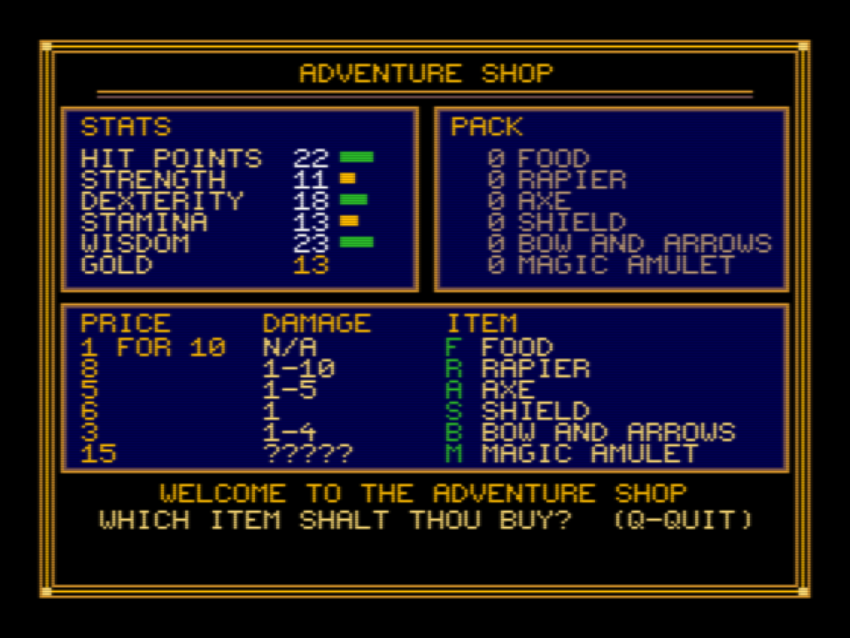

## 4. Telas e comandos

### 4.1 O mundo

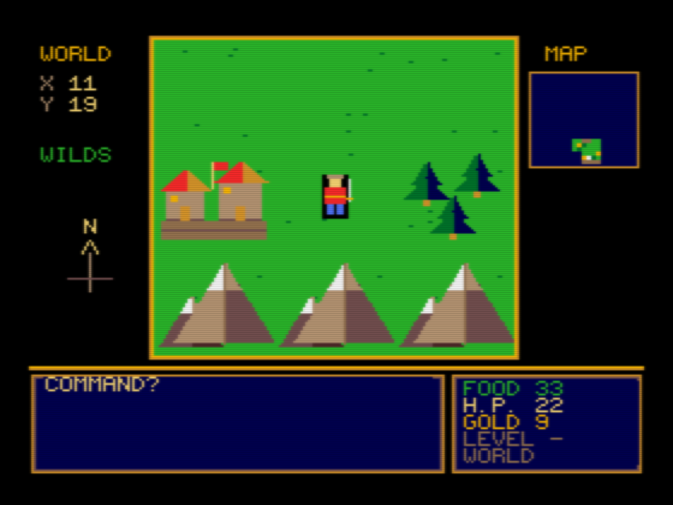

Você vê os 9 quadrados ao seu redor. À esquerda ficam suas coordenadas, o tipo do lugar onde pisa e a bússola. À direita, o **minimapa** das áreas já exploradas.

| Quadrado | O que é |
| --- | --- |
| Grama | Livre. |
| Montanhas | Barram a passagem (`YOU CAN'T PASS THE MOUNTAINS`). O limite do mundo é feito delas. |
| Floresta | Só enfeite. Dá para atravessar. |
| Cidade (casas) | `ENTER` abre a **loja**. Você começa em uma. |
| Buraco no chão | Entrada da **masmorra**. `ENTER` para descer. |
| Castelo | Casa de Lord British. `ENTER` para falar com ele. |

Cada passo no mundo gasta **1 de comida**.

### 4.2 A masmorra

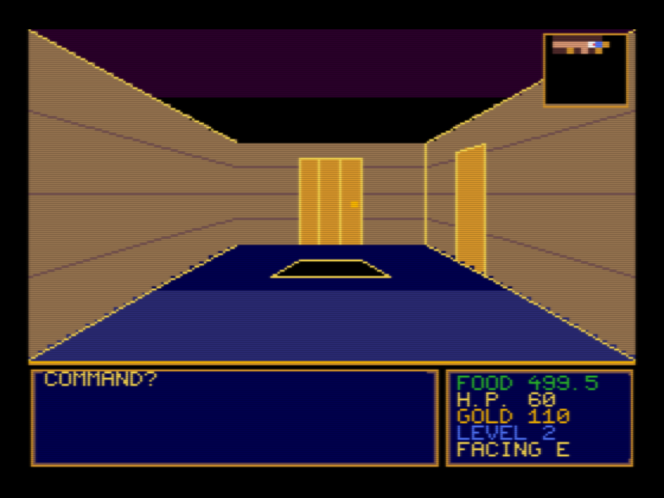

Vista em primeira pessoa. No canto superior direito, o **minimapa** mostra só o que você já viu: paredes escuras, corredores claros, portas marrons, baús dourados, escadas verdes, buracos azuis, monstros visíveis em vermelho e você em branco (o pontinho vermelho indica para onde está olhando).

O painel de baixo mostra mensagens à esquerda; à direita ficam **FOOD** (comida), **H.P.**, **GOLD**, **LEVEL** (andar) e **FACING** (direção). Cada passo na masmorra gasta **0,1 de comida**.

| Elemento | Como é | O que faz |
| --- | --- | --- |
| Porta | Retângulo marrom na parede | Pode ser atravessada. |
| Porta secreta | Parece parede | Também é atravessável: ande para frente. |
| Armadilha | Invisível | Você cai para o andar de baixo e perde `3 + sorteio(nível)` de HP (`FALLING TO LEVEL n`). |
| Buraco no chão | Trapézio preto | `ENTER` desce um andar. |
| Escada | Hastes douradas | `ENTER` sobe ou desce. No andar 1 a escada para cima **sai da masmorra**. |
| Baú | Caixa dourada (`CHEST!`) | Ao pisar: ouro + um item aleatório (inclusive comida). |
| Mímico | **Também parece um baú** | Fica parado e ataca quem chega perto. |

Cada vez que você troca de andar, o andar é gerado de novo. O desenho é o mesmo para o mesmo número da sorte, mas os monstros e os baús **voltam**.

### 4.3 Teclas

| Tecla | Efeito |
| --- | --- |
| **Setas** (ou joystick) | Mundo: norte, leste, oeste, sul. Masmorra: seta para cima = frente, esquerda/direita = virar, para baixo = meia-volta. |
| **ENTER** | Entrar em cidade, masmorra ou castelo; usar escada ou buraco. |
| **A** | Atacar (masmorra). |
| **ESPAÇO** | Passar o turno. |
| **S** | Tela de status (não gasta turno). |
| **H** (ou **?**) | Tela de ajuda com as teclas (não gasta turno). |
| **M** | Liga/desliga a música. |
| **W** | Salva o jogo em `AKALABET.SAV`. |
| **L** | Carrega o jogo salvo. |
| **P** | Liga/desliga a pausa nas mensagens (`-CR- TO CONT.`): com ela ligada o jogo espera uma tecla antes de continuar. |
| **ESC** | Sai para o DOS (pergunta antes). |

## 5. A loja


| Item | Preço | Dano | Observação |
| --- | --- | --- | --- |
| **F**OOD | 1 ouro | — | Cada compra dá **10 de comida**. |
| **R**APIER | 8 | 1–10 | Não serve para magos. |
| **A**XE | 5 | 1–5 | Pode ser **arremessado** (perde-se o machado) ou usado de perto. |
| **S**HIELD | 6 | 1 | Dificulta os golpes dos monstros em você. Também serve para bater. |
| **B**OW AND ARROWS | 3 | 1–4 | Atira até 5 células à frente. Não serve para magos. |
| **M**AGIC AMULET | 15 | ? | Ver seção 7. |

Tecle a letra do item para comprar e **Q** para sair.

## 6. Combate

Pressione **A**, depois a letra da arma (`R`, `A`, `S`, `B`, `M`). Qualquer outra tecla significa lutar com as mãos. Se a arma não for sua, aparece `NOT OWNED`.

- **Corpo a corpo** (rapieira, escudo, mãos, machado de perto): atinge o monstro na célula à sua frente.
- **Arco e machado arremessado:** atingem o primeiro monstro na linha de visão, até 5 células.
- **Seu golpe acerta** com chance de `(DEX − nº do monstro − andar) / 25`.
- **Dano** = sorteio de 0 até o dano da arma + `STR / 5`.
- **O monstro acerta** com chance `1 − (STA + escudo − nº do monstro − andar) / 20`, e o dano é `sorteio(nº do monstro) + andar`.
- Matar um monstro dá `nº do monstro + andar` de ouro e também soma "sorte", que vira **pontos de vida** quando você sai da masmorra (`THOU HAST GAINED n HIT POINTS`).
- Monstros feridos (vida abaixo de `andar × nível de jogo`) **fogem** e se recuperam, mas atacam se ficarem encurralados.

### Os monstros

| Nº | Monstro | Aparece a partir do andar | Notas |
| --- | --- | --- | --- |
| 1 | Skeleton | 1 | |
| 2 | Thief | 1 | 50 % das vezes rouba um item em vez de atacar. |
| 3 | Giant Rat | 1 | |
| 4 | Orc | 2 | |
| 5 | Viper | 3 | |
| 6 | Carrion Crawler | 4 | Fica pendurado no teto. |
| 7 | Gremlin | 5 | 50 % das vezes come **metade da sua comida**. |
| 8 | Mimic | 6 | Disfarçado de baú. |
| 9 | Daemon | 7 | |
| 10 | Balrog | 8 | O último. |

O monstro `n` só aparece a partir do andar `n − 2`, e cada um tem 40 % de chance de estar em cada andar.

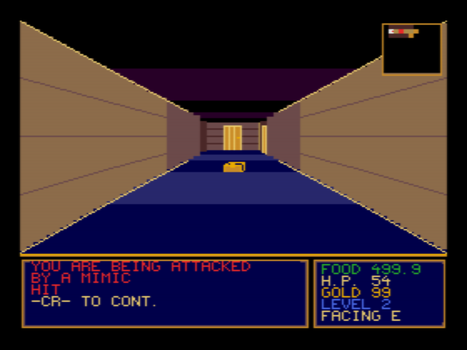

## 7. O amuleto mágico

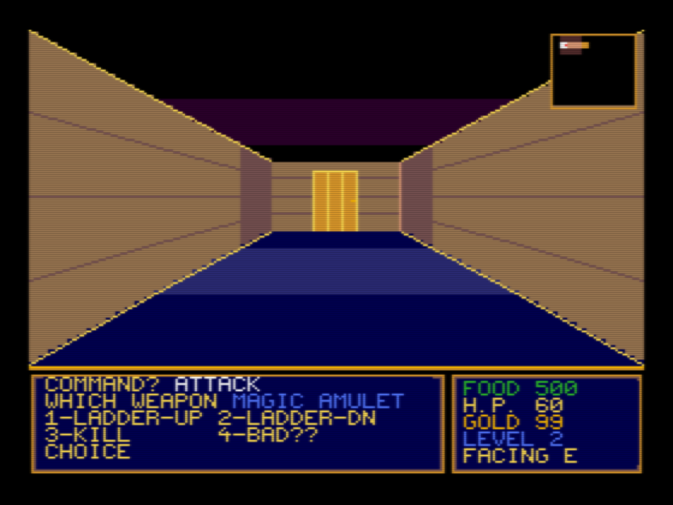

- **Lutador:** cada uso sorteia um dos quatro efeitos abaixo.
- **Mago:** escolhe o efeito. A cada uso há 25 % de chance de o amuleto perder uma carga (`LAST CHARGE ON THIS AMULET!`).

| Opção | Efeito |
| --- | --- |
| 1 — LADDER UP | Cria uma escada para cima onde você está. |
| 2 — LADDER DN | Cria uma escada para baixo onde você está. |
| 3 — KILL | Ataque mágico em linha reta (dano até `10 + andar`). |
| 4 — BAD?? | Arriscado: **Toad** (força, destreza, estamina e sabedoria viram 3), **Lizard Man** (todos os atributos ×2,5, ouro não) ou **Backfire** (perde metade do HP). |

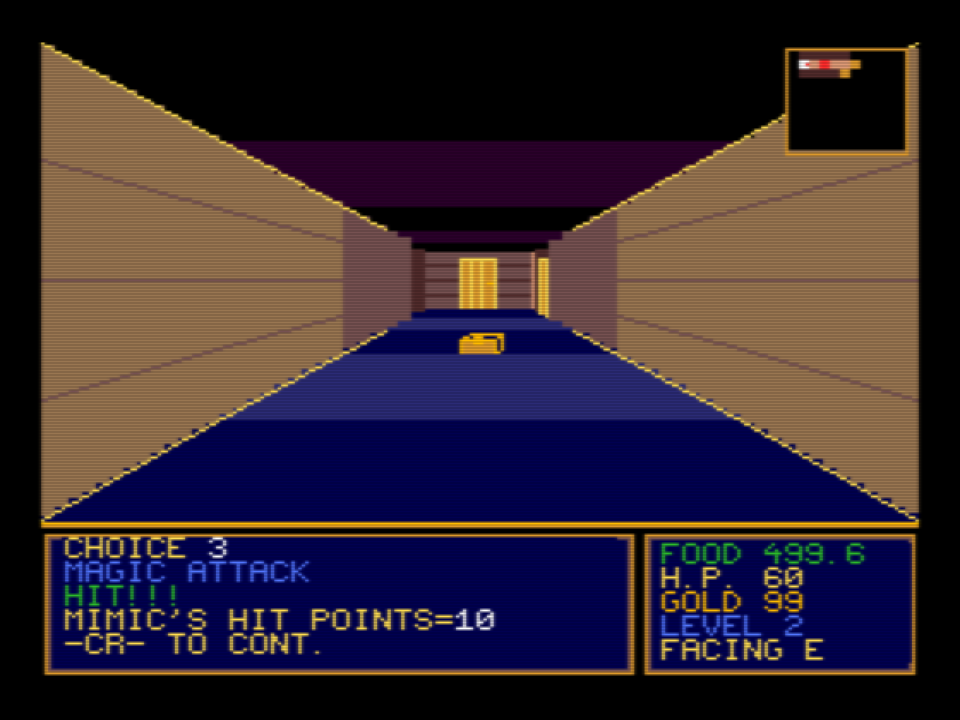

## 8. As missões de Lord British

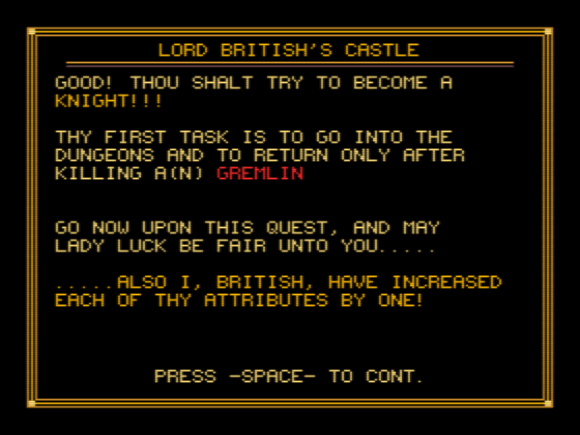

1. Vá ao **castelo** (`ENTER` sobre ele). Na primeira vez, diga seu nome e aceite o desafio.
2. O primeiro monstro é o de número `sabedoria / 3` (no mínimo 1). Mate **um** deles na masmorra e volte.
3. Ao voltar, se a missão está cumprida, o rei reconhece, **soma 1 a todos os seus atributos** e pede o monstro seguinte.
4. Quando você matar o **Balrog** (o último da sequência) e voltar ao castelo, é sagrado **Lord** e pode continuar jogando num nível de jogo mais alto, se quiser.
5. Se voltar sem ter matado o monstro, ele manda você voltar à missão.

## 9. Morte, comida e perigos

- **Fome:** sem comida você morre de fome (`YOU HAVE STARVED!`). Compre comida sempre que passar por uma cidade.
- **Morte:** aparece a lápide. Tecle **ESC** ou **ENTER** para voltar ao título e começar de novo.

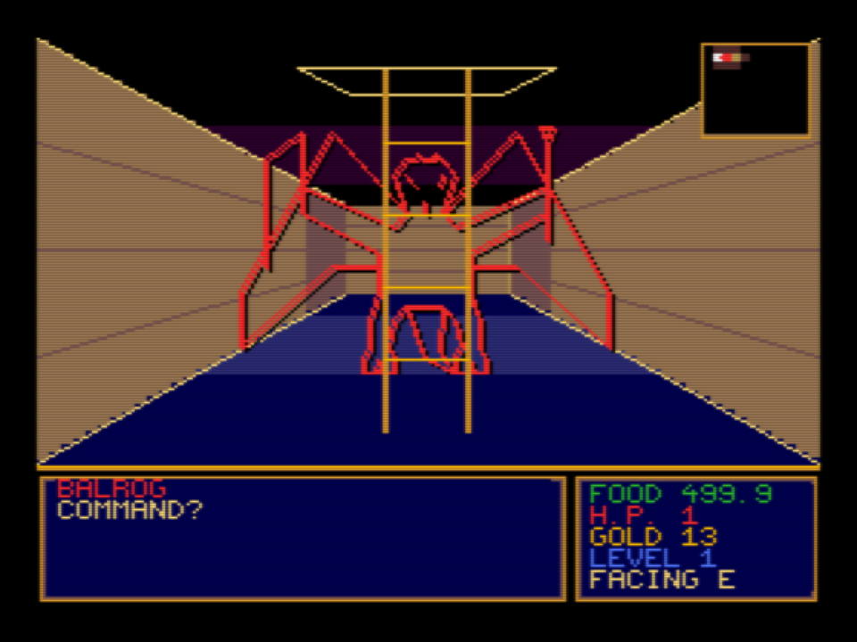

## 10. Salvar e carregar

- **W** salva em `AKALABET.SAV` (1248 bytes, no disco atual). **L** carrega, a qualquer momento ou no título.
- O arquivo guarda personagem, mundo, andar, monstros, mapa explorado e posição.
- Só funciona com **MSX-DOS 2**.

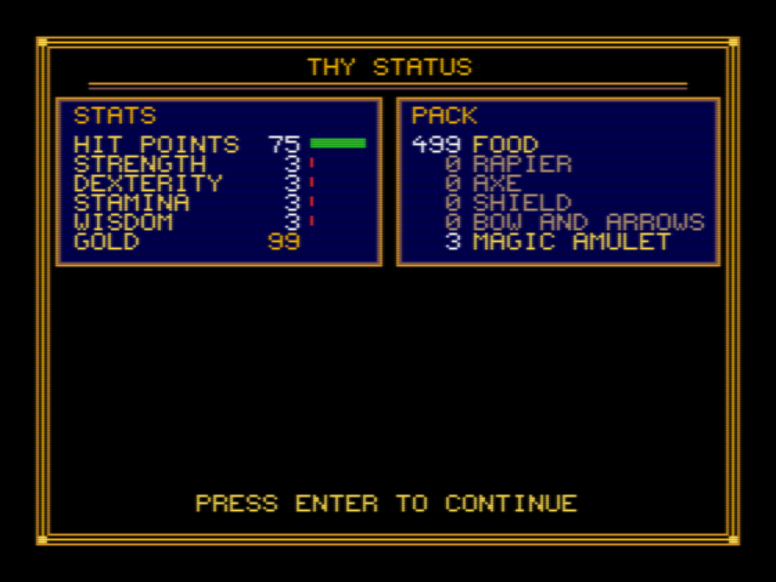

## 11. Música e efeitos

Cinco temas originais de 3 vozes (título, mundo, masmorra, castelo/loja e vitória) e 14 efeitos pelo PSG. Com a RAM mapeada, cada tema dura de 30 a 50 s antes de repetir; sem ela, tocam versões curtas. **M** liga e desliga a música; os efeitos continuam.

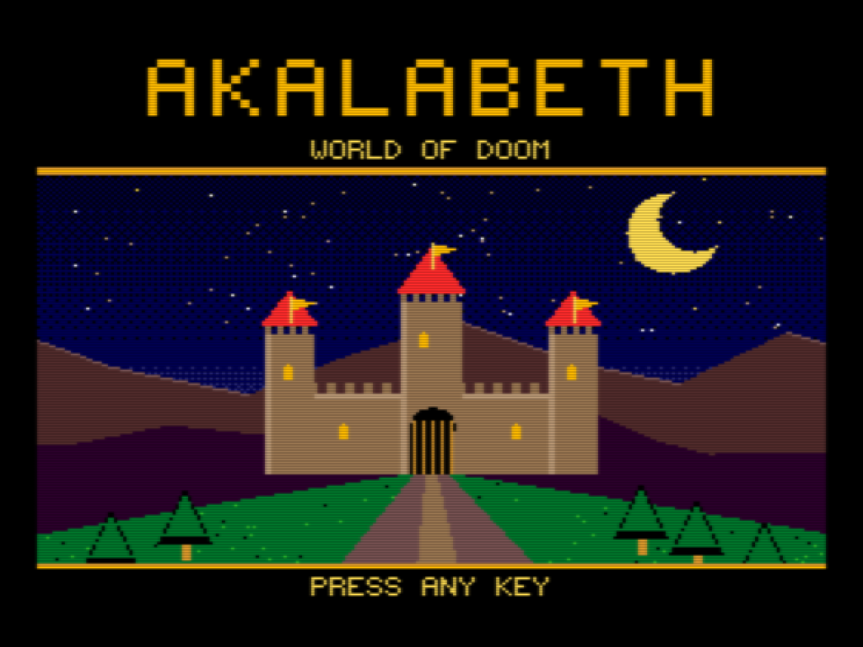

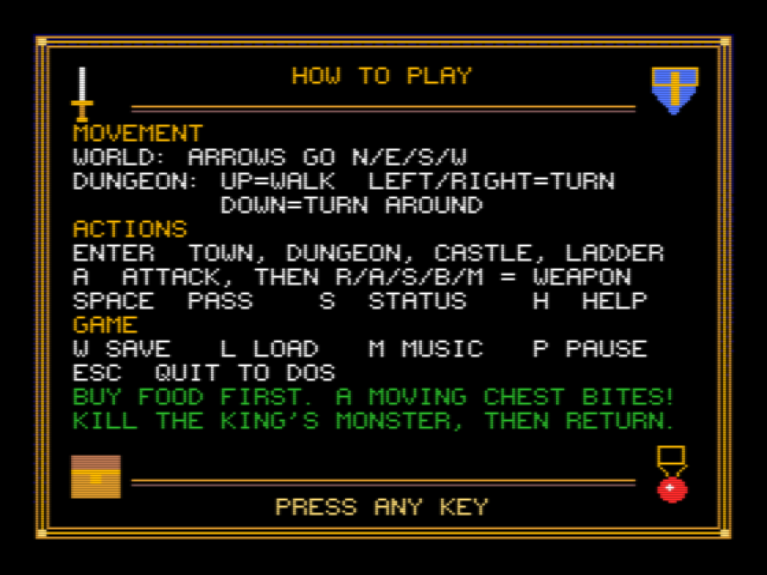

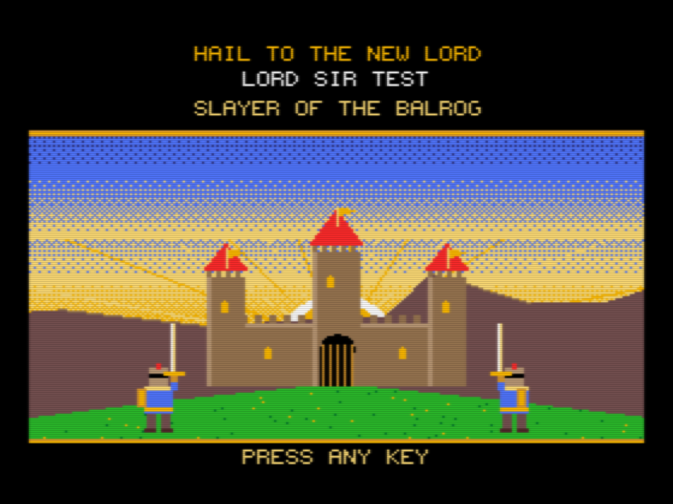

## 12. Dicas

1. Gaste ouro em **comida** antes de tudo; depois compre uma arma.
2. O **machado** serve para quem tem pouca destreza: atirar acerta de longe, mas ele se perde.
3. Confie no **minimapa**: ele mostra por onde você já passou e onde ficaram as escadas.
4. Um **baú** que se mexe não é baú. Desconfie dos baús em andares fundos.
5. Antes de entrar fundo, **salve** (`W`).
6. Para sair de uma masmorra sem escada por perto, o amuleto cria uma.
7. Sair da masmorra devolve **HP** proporcional aos monstros que você matou.

## 13. Problemas conhecidos

- O joystick ainda não foi testado em hardware real.
- Um passo na masmorra leva cerca de 0,55 s; no mundo, cerca de 0,3 s.
